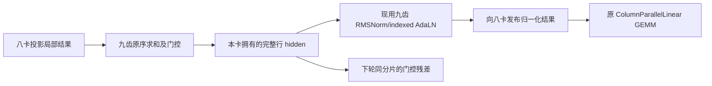

# 分片门控后归一化，再发布结果

本目录是八卡独立原型，**尚未接入真实模型，不得当作正式 peer 门控库直接启用**。当前正式配置仍为 `peer-gate-nt-f13r1n16`，已有稳态官方 A 完整请求均值 120.698043 秒。本原型没有新的模型或完整生成成绩。

## 计算边界

现用版本先分片求和/门控，再向八卡发布完整 hidden，由各卡重复执行宽 RMSNorm/indexed AdaLN。原型改为：



每卡处理 `[floor(N*r/8),floor(N*(r+1)/8))` 行，行宽 5376。不切开单行，RMSNorm 继续使用现用完整镜像及原来的 FP32 归约顺序。求和镜像只将起始索引从 `rank*(count/8)` 改为运行时的行对齐 offset，原 BF16 累加、门控、残差舍入顺序及运行时 RCCL 校准位置表保留。

prototype 的 `hidden` 是完整形状的缓冲区，只有本卡拥有的行有效；归一化输出在紧凑工作区计算，再发布为各卡完整有效的输出。门控新 hidden、归一化输出与输入/残差不得重叠。RMSNorm weight、调制表与 indices 需要在各 TP rank 间复制。连续三轮局部残差测试检查未拥有区域始终保持哨兵，避免误把未初始化数据当作有效 hidden。

## 两个主机调度对照

默认构建在一个八 worker 汇合中连续发射 gate、norm、publish，用于先验证数学和收益预算。`--split-arrivals` 在 gate 回调返回后，再由八 worker 分别进入归一化汇合，模拟模型中两个独立阶段的主机开销。它们使用同一求和、归一化镜像和发布 kernel，不改变数学计算。

`chain_bridge.cc` 保留 `h3_peer_bridge_raw` 供微测适配，但该原型返回的是归一化结果，语义与正式普通 gate 回调不同。只有显式初始化 norm callback 和每 worker 的 TLS 参数后才能调用，缺少上下文会拒绝。后续模型接入必须实现独立的分片 gate、分片 norm 和末层物化接口，不能绕过这个限制直接注册。

## 构建与验证

按运行 skill 激活 DTK/Torch 环境，设置 `H3_AUTOTUNE_CODE_ROOT`，输出目录必须不存在：

```bash
python build-row-gate.py "$new_nt" --tile 1024 --warps 4
python build.py "$new_nt" "$new_runtime" --split-arrivals

python bench-chain.py "$new_runtime" "$new_result" \
    --reference "$accepted_peer" --indexed "$accepted_indexed" \
    --norm "$accepted_wide_norm" --pairs 39

# 独立消费者诊断，包含额外GPU拷贝，不能当作干净性能。
python bench-chain.py "$new_runtime" "$new_consumer_result" \
    --reference "$accepted_peer" --indexed "$accepted_indexed" \
    --norm "$accepted_wide_norm" --pairs 3 --consumer-copy --case special
```

`bench-chain.py` 验证实际设备镜像与 host/transport SHA，使用同一 InfiniCCL communicator 和八个持久 worker。先检查归一化完整输出、局部 hidden、非拥有区域及尾部哨兵，再交替计时；每次在计时外恢复局部投影输入。计时后连续三轮把本卡分片 hidden 用作下一轮残差，额外检查不混入配对时间。Tree 回退会原地修改局部输入，诊断也必须恢复输入后再跑另一侧。

`--profile-candidate-only` 仅用于独立 hipprof 工作负载，不执行对照或数值资格，输出明确标记 `numerical_qualified=false`。它运行三次候选，可分别采集 `h3_peer_gate_kernel`、`wide_norm_indexed_kernel`、`publish_rows`，每份应实际有八卡各三条目标记录。Trace 的 `[profile.begin/end]` 使用 epoch ns，对应分析应读取事件的 `args.BeginNs/EndNs`，不能混用相对 `ts`。

## 当前结果与后续闸门

`f13r1n16` 两次独立 split 配对中，A 对应长度每批中位差额约 0.79136 / 0.77680 ms；三个生产长度均通过普通、极小值、大幅值、NaN/Inf、GPU消费者及连续三轮残差检查。Tree 强制回退为 0 fused / 9 fallback，完整输出和消费者检查通过。重建 split 的 C++/HIP 库逐字节相同，NT 镜像的全部可加载区段与映射相同。

模型有 50 层、100 个块内 norm；最初的 norm1 没有前驱门控，因此只能对每次 Transformer 的 **99 个位置**做投影。按 49 次 Transformer 的 4851 次调用，当前微测投影约 3.12%–3.18% 完整 A 收益；尚未计入模型集成、最后 hidden 物化的实际差额，不能作为端到端成绩。

后续接入前需要落实：

1. 保留当前行分片的 Tensor 身份和生命周期，跨 rank/请求不能串用；门控残差只读本卡有效行。
2. 初始 norm1 使用完整输入；后续 norm 在分片上执行并发布完整结果供 GEMM 使用。原矩阵形状和计算不变。
3. 末层 FFN 之后、`norm_out` 之前显式物化完整 hidden；不支持的 norm、回退和关闭切换前同样物化。
4. 运行时检查实际模型的 RMSNorm weight、调制表及索引复制前提；校准失败时明确区分完整 hidden 和分片 hidden。
5. 先跑真实八卡第 1/25/49 步逐位与无 profiler 配对，再跑完整官方 A、稳态三组、B/C/返回 A、质量和内存。对照应为当前已验收的 peer 版本，不能把原 AllReduce 版本当作本轮优化对照。

完整数据见 [分片归一化原型记录](../../docs/分片归一化原型-f13r1n16.md)。早期 inline 镜像仅保留产物 SHA 和原始实验记录；推荐构建与独立重建证据均针对最终 split 形式。
