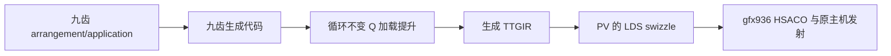

# MiniMax-H3 长注意力编译优化实测

在已验收 v3 上增加九齿生成代码的只读 Q 加载提升和 PV LDS swizzle。单算子耗时约减少 19%，真实八卡 Transformer 早、中、晚期回放的三个中位数合计减少 12.81%，video/audio 输出均与同轮 v3 哈希一致。新开关默认关闭。后续 Q64/4 warps 候选已将真实八卡 Transformer 回放节省提高到 19.60%，下文分别记录两版证据；正式稳态收益单独测量。

## 计算与编译路径

点积、softmax、BF16 PV、FP32 缩放与累积、完整 KV 遍历保持原表达式。Q 加载提升检查依赖关系；出现全局写回、原子操作或不符合预期的加载数时拒绝构建。LDS 变换检查已验证的形状及布局，避免对未知编译输出静默套用。新增计算继续由九齿表达并通过其编译链生成。

## 单算子与硬件计数

节点 `f12r1n15`，八卡 BW1000 分配 `1210413`。单算子使用一张卡，BF16、7 heads、head dim 128，Q/K/V 保持生产 packed stride，两个长度均有 11 组交替顺序的 GPU event 配对。计时与 hipprof trace/PMC 分开。

| token 数 | 同轮 v3 中位数 (ms) | 候选中位数 (ms) | 配对节省 | 普通与放大 Q/K |
| ---: | ---: | ---: | ---: | --- |
| 27570 | 60.497101 | 48.997417 | 18.95% | 逐位一致，max abs = RMSE = 0 |
| 22016 | 38.711029 | 31.393908 | 18.89% | 逐位一致，max abs = RMSE = 0 |

27570 token 的全局读取指令由 124,777,086 降至 83,232,975，减少 33.29%；LDS 指令减少 7.68%。LDS bank conflict 原始计数从 2,663,069,696 降至 166,441,856，减少 93.75%。资源由 168 VGPR、8192 B LDS、0 B Scratch 变为 180 VGPR、8192 B LDS、0 B Scratch。原始计数及其归一化比例属于不同指标，不能混用。

## 八卡真实去噪回放

同一个模型实例中，对第 1、25、49 次真实去噪输入分别测 v3 与候选，每侧一次预热、三次同步墙钟计时。它们按变体依次测量，存在顺序影响；本项是 Transformer 调用回放，不能直接作为完整生成加速比。

| 去噪调用 | v3 中位数 (s) | 候选中位数 (s) | 节省 | video/audio |
| ---: | ---: | ---: | ---: | --- |
| 1 | 4.493818 | 3.920705 | 12.75% | 输出哈希一致且有限 |
| 25 | 4.496100 | 3.920298 | 12.81% | 输出哈希一致且有限 |
| 49 | 4.499584 | 3.920017 | 12.88% | 输出哈希一致且有限 |

## 候选取舍

自动框架的第 1–21 轮均保留在本机工作区。强制增加 wave 并发出现 Scratch 并大幅回退；调度提示及 Q 往返类型转换未改变有效代码；PV 转置写法数值失败；单次累加物化 Q、提前 LSE 归约和尾部 mask 分支没有收益。第 11 轮 Q 加载提升首先得到约 8% 单算子收益，第 14 轮叠加 LDS 布局后进一步加快。

第 18–20 轮约为 49.0 / 31.4 ms，耗时差异很小。第 19 轮 VGPR 最低为 180，优先集成；第 20 轮为 188 VGPR，未把其不到 0.1 ms 的差异解释成明确更优。双阶段 local prefetch 的第 21 轮使用 252 VGPR、18432 B LDS，耗时增至 91.858 / 58.807 ms，已淘汰。

## 重建与回归

`build-attention-aot.py --optimize-long-attention` 只允许已测量的 aligned K32、Q32/2 warps 或 Q64/4 warps、1 stage、kpack=2、BF16 PV、FP32 scale 组合。`rebuild-v2.sh --long-attention-lds` 选择 Q32，`--long-attention-q64` 选择 Q64。

关闭新开关的设备可加载区段与正式 v3 相同；集成后的设备可加载区段与第 19 轮相同，两侧主机库均文件一致。加入内存副作用检查后再次重建，设备与主机产物仍相同。15 个短长度及分块边界的普通与放大 Q/K 输入全部逐位一致。依赖 KV 下标的读取、循环内 store 和 atomic 会被安全检查拒绝。

完整公开 A 的普通 `fl2va` 入口已完成，本地检查通过。参数为 768×928、50 steps、124 帧、seed 42，完整执行 49 次 Transformer；视频为 24 fps H.264，音频为 32 kHz 双声道 AAC。原官方函数测得平均 SSIM 为 93.832013%，最低帧为 87.920202%。新生成 MP4 的 SHA-256 与已验收 v3 完全一致，为 `99d975c6e2537274224d5904eb35dc30ba3f350737ebe333b9d43c61882f0440`。

本轮是单次独立冷启动，Transformer 累计 194.521 s、生成管线 274.594 s，含模型加载的总端到端为 938.131 s。条件编码器首次调用为 39.053 s、视频 VAE 解码为 32.687 s。上述冷启动数值不能与此前 v3 的正式稳态请求 241.306 s 直接比较，也不作为正式稳态加速比。正式默认配置仍为已验收 v3，新候选单独保留。

## 材料位置

本机完整证据位于 `/public/home/acvduipmem/xsh/songshanbei/optimization/dcu-kernel-autotune`。`rounds/h3-long-attention/` 保存各轮源码、编译 IR、计时、数值、trace 和 PMC；`validation/round_019/` 保存八卡输出哈希；`validated-build/` 保存重建区段对照、安全检查与候选配置；`validation/round_019-official/` 保存公开 A。仓库只携带框架、基线源码模板、可重现的候选增量与精简报告，模型权重和大型运行数据保留在本机。

## 后续单算子候选

第 23 轮在相同优化上改用 Q64/K32、4 warps，并将 P 布局设为 `vec=8, perPhase=1, maxPhase=8`。两个长度为 42.953 / 27.977 ms，同轮配对节省 29.44% / 27.57%，普通和放大输入仍逐位一致。资源为 180 VGPR、16384 B LDS、0 B Scratch。真实八卡及完整质量尚待验证，因此本次集成开关仍对应已完整检查的第 19 轮，不把第 23 轮微测等同于正式生成收益。

## 第 25 轮 Q64 的工程验证

P 改用 `vec=8, perPhase=2, maxPhase=8` 后 VGPR 从 180 降到 176，单算子为 43.025581 / 28.047188 ms，与第 23 轮接近。Q64 的全局读取指令较 v3 减少约 66.63%，27570 token 的 PMC TCC HIT/(HIT+MISS) 由约 75.88% 变为 97.72%；该比例不等同于端到端性能。LDS bank conflict 原始计数仍为 166,441,856。

| 去噪调用 | 同轮 v3 中位数 (s) | Q64 中位数 (s) | video/audio |
| ---: | ---: | ---: | --- |
| 1 | 4.491341 | 3.611887 | 哈希一致且有限 |
| 25 | 4.492939 | 3.613009 | 哈希一致且有限 |
| 49 | 4.494204 | 3.612387 | 哈希一致且有限 |

三个中位数合计节省 **19.5957%**。仍为同实例按变体依次执行的回放，未交替配对，不能当作完整生成的正式加速比。集成重建的主机库、设备加载区段与 ELF 映射均与第 25 轮一致；15 个边界长度的普通和放大输入全部逐位一致。普通完整公开 A 在 `validation/round_025-official` 已通过本地检查，规格 768×928、50 steps、124 帧、seed 42，执行 49 次 Transformer，平均 SSIM 93.832013%。新生成 MP4 的 SHA-256 与已验收 v3 完全一致。候选配置为 `validated-build/q64-candidate.env`，默认在稳态、多用例回归完成前仍为已验收 v3。

本次独立冷启动中 Transformer 累计 179.531 s，生成管线 258.103 s；条件编码器首次调用 39.462 s，视频 VAE 解码 30.366 s，音频解码 2.010 s。使用已逐文件核对的节点本地权重，模型加载合计约 47.792 s，进程内端到端 308.183 s。相比第 19 轮共享盘冷启动的总时间减少主要来自权重读取，不能全部归因于内核优化；正式稳态加速比仍单独测量。

后续实验排除了提前 LSE、提前 V、Q128/4 warps；强制 MFMA32 未进入预期 BF16 矩阵路径，布局检查正确拒绝构建。PV kWidth8 和 MFMA warp 2×2 造成浮点差异并且更慢，均在数值门槛拦截，没有采集 trace/PMC。进一步检查双阶段 global prefetch、kpack1、调度提示、QK 的 K 暂存和 Q128 的调度组合，具体状态记录在工作区长期任务文档。

## 第 40 轮：完整 KV 分块与尾块分离

在 Q64 的九齿 application 中先遍历 `N // 32` 个完整 KV 分块，省去这些分块的 QK 尾部掩码，再按原顺序处理剩余尾块。每个 Q 仍遍历全部 KV，保留 BF16 PV、FP32 缩放与累积。该轮使用两个内层循环，各提升一个只读 Q 分块，LDS 布局仍为第 25 轮的 P8/2/8、V8/1/16。

两个长度为 42.219349 / 27.349272 ms，对同轮 v3 配对节省 30.4881% / 29.1753%。另以第 25 轮直接参考，11 组交替配对确认额外节省 1.8944% / 2.5217%。普通及放大输入逐位一致，15 个小长度/边界检查通过。资源为 180 VGPR、16384 B LDS、0 B Scratch。

| 去噪调用 | 同轮 v3 中位数 (s) | 第 40 轮中位数 (s) | video/audio |
| ---: | ---: | ---: | --- |
| 1 | 4.493422 | 3.572485 | 哈希一致且有限 |
| 25 | 4.493408 | 3.572875 | 哈希一致且有限 |
| 49 | 4.497162 | 3.573413 | 哈希一致且有限 |

三个中位数合计节省 **20.5074%**，仍是同实例按变体依次执行的回放，有顺序影响。本轮源码冻结在自动框架 `candidates/long-attention-q64-tail/source_delta`，可以通过隔离源码流程重建；尚未增加正式顶层构建开关，也没有完成本轮的完整 A、多用例或稳态验证。第 25 轮的完整成片证据不套用于本轮，正式默认配置仍为 v3。

后端调度提示的第 34/38 轮在当前 DTK LLVM 的 IGLP 调度组构造中出现持续内存增长，保存证据后分别终止及超时，没有 GPU 性能结论。第 39 轮移除 IGLP 后与第 25 轮的加载区段、映射和主机库相同，跳过重复 GPU 测量。候选构建已加入默认 180 s 时限。
