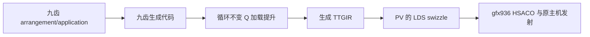

# MiniMax-H3 长注意力编译优化实测

在已验收 v3 上增加九齿生成代码的只读 Q 加载提升和 PV LDS swizzle。单算子耗时约减少 19%，真实八卡 Transformer 早、中、晚期回放的三个中位数合计减少 12.81%，video/audio 输出均与同轮 v3 哈希一致。新开关默认关闭。后续 Q64/4 warps 候选已将真实八卡 Transformer 回放节省提高到 19.60%，下文分别记录两版证据；正式稳态收益单独测量。

## 计算与编译路径

点积、softmax、BF16 PV、FP32 缩放与累积、完整 KV 遍历保持原表达式。Q 加载提升检查依赖关系；出现全局写回、原子操作或不符合预期的加载数时拒绝构建。LDS 变换检查已验证的形状及布局，避免对未知编译输出静默套用。新增计算继续由九齿表达并通过其编译链生成。

## 单算子与硬件计数

节点 `f12r1n15`，八卡 BW1000 分配 `1210413`。单算子使用一张卡，BF16、7 heads、head dim 128，Q/K/V 保持生产 packed stride，两个长度均有 11 组交替顺序的 GPU event 配对。计时与 hipprof trace/PMC 分开。

| token 数 | 同轮 v3 中位数 (ms) | 候选中位数 (ms) | 配对节省 | 普通与放大 Q/K |
| ---: | ---: | ---: | ---: | --- |
| 27570 | 60.497101 | 48.997417 | 18.95% | 逐位一致，max abs = RMSE = 0 |
| 22016 | 38.711029 | 31.393908 | 18.89% | 逐位一致，max abs = RMSE = 0 |

27570 token 的全局读取指令由 124,777,086 降至 83,232,975，减少 33.29%；LDS 指令减少 7.68%。LDS bank conflict 原始计数从 2,663,069,696 降至 166,441,856，减少 93.75%。资源由 168 VGPR、8192 B LDS、0 B Scratch 变为 180 VGPR、8192 B LDS、0 B Scratch。原始计数及其归一化比例属于不同指标，不能混用。

## 八卡真实去噪回放

同一个模型实例中，对第 1、25、49 次真实去噪输入分别测 v3 与候选，每侧一次预热、三次同步墙钟计时。它们按变体依次测量，存在顺序影响；本项是 Transformer 调用回放，不能直接作为完整生成加速比。

| 去噪调用 | v3 中位数 (s) | 候选中位数 (s) | 节省 | video/audio |
| ---: | ---: | ---: | ---: | --- |
| 1 | 4.493818 | 3.920705 | 12.75% | 输出哈希一致且有限 |
| 25 | 4.496100 | 3.920298 | 12.81% | 输出哈希一致且有限 |
| 49 | 4.499584 | 3.920017 | 12.88% | 输出哈希一致且有限 |

## 候选取舍

自动框架的第 1–21 轮均保留在本机工作区。强制增加 wave 并发出现 Scratch 并大幅回退；调度提示及 Q 往返类型转换未改变有效代码；PV 转置写法数值失败；单次累加物化 Q、提前 LSE 归约和尾部 mask 分支没有收益。第 11 轮 Q 加载提升首先得到约 8% 单算子收益，第 14 轮叠加 LDS 布局后进一步加快。

第 18–20 轮约为 49.0 / 31.4 ms，耗时差异很小。第 19 轮 VGPR 最低为 180，优先集成；第 20 轮为 188 VGPR，未把其不到 0.1 ms 的差异解释成明确更优。双阶段 local prefetch 的第 21 轮使用 252 VGPR、18432 B LDS，耗时增至 91.858 / 58.807 ms，已淘汰。

## 重建与回归

`build-attention-aot.py --optimize-long-attention` 只允许已测量的 aligned K32、Q32/2 warps 或 Q64/4 warps、1 stage、kpack=2、BF16 PV、FP32 scale 组合。`rebuild-v2.sh --long-attention-lds` 选择 Q32，`--long-attention-q64` 选择 Q64。

关闭新开关的设备可加载区段与正式 v3 相同；集成后的设备可加载区段与第 19 轮相同，两侧主机库均文件一致。加入内存副作用检查后再次重建，设备与主机产物仍相同。15 个短长度及分块边界的普通与放大 Q/K 输入全部逐位一致。依赖 KV 下标的读取、循环内 store 和 atomic 会被安全检查拒绝。

完整公开 A 的普通 `fl2va` 入口已完成，本地检查通过。参数为 768×928、50 steps、124 帧、seed 42，完整执行 49 次 Transformer；视频为 24 fps H.264，音频为 32 kHz 双声道 AAC。原官方函数测得平均 SSIM 为 93.832013%，最低帧为 87.920202%。新生成 MP4 的 SHA-256 与已验收 v3 完全一致，为 `99d975c6e2537274224d5904eb35dc30ba3f350737ebe333b9d43c61882f0440`。

本轮是单次独立冷启动，Transformer 累计 194.521 s、生成管线 274.594 s，含模型加载的总端到端为 938.131 s。条件编码器首次调用为 39.053 s、视频 VAE 解码为 32.687 s。上述冷启动数值不能与此前 v3 的正式稳态请求 241.306 s 直接比较，也不作为正式稳态加速比。正式默认配置仍为已验收 v3，新候选单独保留。

## 材料位置

本机完整证据位于 `/public/home/acvduipmem/xsh/songshanbei/optimization/dcu-kernel-autotune`。`rounds/h3-long-attention/` 保存各轮源码、编译 IR、计时、数值、trace 和 PMC；`validation/round_019/` 保存八卡输出哈希；`validated-build/` 保存重建区段对照、安全检查与候选配置；`validation/round_019-official/` 保存公开 A。仓库只携带框架、基线源码模板、可重现的候选增量与精简报告，模型权重和大型运行数据保留在本机。

## 后续单算子候选

第 23 轮在相同优化上改用 Q64/K32、4 warps，并将 P 布局设为 `vec=8, perPhase=1, maxPhase=8`。两个长度为 42.953 / 27.977 ms，同轮配对节省 29.44% / 27.57%，普通和放大输入仍逐位一致。资源为 180 VGPR、16384 B LDS、0 B Scratch。真实八卡及完整质量尚待验证，因此本次集成开关仍对应已完整检查的第 19 轮，不把第 23 轮微测等同于正式生成收益。

## 第 25 轮 Q64 的工程验证

P 改用 `vec=8, perPhase=2, maxPhase=8` 后 VGPR 从 180 降到 176，单算子为 43.025581 / 28.047188 ms，与第 23 轮接近。Q64 的全局读取指令较 v3 减少约 66.63%，27570 token 的 PMC TCC HIT/(HIT+MISS) 由约 75.88% 变为 97.72%；该比例不等同于端到端性能。LDS bank conflict 原始计数仍为 166,441,856。

| 去噪调用 | 同轮 v3 中位数 (s) | Q64 中位数 (s) | video/audio |
| ---: | ---: | ---: | --- |
| 1 | 4.491341 | 3.611887 | 哈希一致且有限 |
| 25 | 4.492939 | 3.613009 | 哈希一致且有限 |
| 49 | 4.494204 | 3.612387 | 哈希一致且有限 |

三个中位数合计节省 **19.5957%**。仍为同实例按变体依次执行的回放，未交替配对，不能当作完整生成的正式加速比。集成重建的主机库、设备加载区段与 ELF 映射均与第 25 轮一致；15 个边界长度的普通和放大输入全部逐位一致。普通完整公开 A 在 `validation/round_025-official` 已通过本地检查，规格 768×928、50 steps、124 帧、seed 42，执行 49 次 Transformer，平均 SSIM 93.832013%。新生成 MP4 的 SHA-256 与已验收 v3 完全一致。候选配置为 `validated-build/q64-candidate.env`，默认在稳态、多用例回归完成前仍为已验收 v3。

本次独立冷启动中 Transformer 累计 179.531 s，生成管线 258.103 s；条件编码器首次调用 39.462 s，视频 VAE 解码 30.366 s，音频解码 2.010 s。使用已逐文件核对的节点本地权重，模型加载合计约 47.792 s，进程内端到端 308.183 s。相比第 19 轮共享盘冷启动的总时间减少主要来自权重读取，不能全部归因于内核优化；正式稳态加速比仍单独测量。

后续实验排除了提前 LSE、提前 V、Q128/4 warps；强制 MFMA32 未进入预期 BF16 矩阵路径，布局检查正确拒绝构建。PV kWidth8 和 MFMA warp 2×2 造成浮点差异并且更慢，均在数值门槛拦截，没有采集 trace/PMC。进一步检查双阶段 global prefetch、kpack1、调度提示、QK 的 K 暂存和 Q128 的调度组合，具体状态记录在工作区长期任务文档。

## 第 40 轮：完整 KV 分块与尾块分离

在 Q64 的九齿 application 中先遍历 `N // 32` 个完整 KV 分块，省去这些分块的 QK 尾部掩码，再按原顺序处理剩余尾块。每个 Q 仍遍历全部 KV，保留 BF16 PV、FP32 缩放与累积。该轮使用两个内层循环，各提升一个只读 Q 分块，LDS 布局仍为第 25 轮的 P8/2/8、V8/1/16。

两个长度为 42.219349 / 27.349272 ms，对同轮 v3 配对节省 30.4881% / 29.1753%。另以第 25 轮直接参考，11 组交替配对确认额外节省 1.8944% / 2.5217%。普通及放大输入逐位一致，15 个小长度/边界检查通过。资源为 180 VGPR、16384 B LDS、0 B Scratch。

| 去噪调用 | 同轮 v3 中位数 (s) | 第 40 轮中位数 (s) | video/audio |
| ---: | ---: | ---: | --- |
| 1 | 4.493422 | 3.572485 | 哈希一致且有限 |
| 25 | 4.493408 | 3.572875 | 哈希一致且有限 |
| 49 | 4.497162 | 3.573413 | 哈希一致且有限 |

三个中位数合计节省 **20.5074%**，仍是同实例按变体依次执行的回放，有顺序影响。本轮源码冻结在自动框架 `candidates/long-attention-q64-tail/source_delta`。正式入口已增加 `rebuild-v2.sh --long-attention-q64-tail`，底层为 `build-attention-aot.py --optimize-long-attention --split-kv-tail`。尾块应用单独保存在 `tail_attention.py`，限制 Q64/K32、4 warps 的已验证组合；生成代码须精确提升两个内层循环的 Q 加载。新重建产物与第 40 轮的设备加载区段、映射和主机库一致，15 个边界长度的普通/放大输入均逐位一致。证明见框架 `docs/q64-tail-rebuild-proof.json`、`docs/q64-tail-boundaries.json`。

完整成片、当前节点正式稳态及多用例切换已在 `validation/round_040-steady` 完成，退出码0。预登记序列 A×8,B,C,A，双方各一次完整预热，三组配对 [2,3]、[5,4]、[6,7]；同一常驻实例只切换长注意力，其他 v3 特征、输入及模型工作量相同。

| 正式阶段 | 同节点v3均值 ± 样本标准差(s) | 第40轮均值 ± 样本标准差(s) | 耗时下降 |
| --- | ---: | ---: | ---: |
| 请求端到端 | 240.533937 ± 0.460394 | 195.138460 ± 0.862244 | **18.872795%** |
| 完整 Transformer | 220.292703 ± 0.011851 | 175.072892 ± 0.013555 | **20.527149%** |
| 生成管线 | 238.925767 ± 0.502315 | 193.520753 ± 0.882925 | 19.003816% |

全部11请求完成独立参考比较，A/B/C平均SSIM为93.832013% / 99.404123% / 99.630047%，MP4各自与对应v3成片哈希相同；返回A仍一致。B、C候选墙钟147.901742 / 159.356262s。A规格为原默认768×928、50 steps、124帧、seed42，每请求49次Transformer。视频VAE候选均值13.644915s、输入VAE0.862907s、条件编码0.312038s、音频解码0.242683s、封装1.586083s；这些其他阶段未在本轮优化。

模型加载约55.926s，预热与正式计时分开。整实例显存为5秒整卡采样，最大33752MiB/卡，包含两种注意力库及累积内存池，不能用于宣称独立实例显存节省。精简完整证据见 [round40-steady-final.json](dcu-kernel-autotune/docs/round40-steady-final.json)；原始逐请求记录、源码快照、媒体与采样保留在本机。正式默认仍待普通入口原默认参数复核及下一轮候选筛选后统一更新，禁止把已有完整结果继续当作“基线未完成”。

后端调度提示的第 34/38 轮在当前 DTK LLVM 的 IGLP 调度组构造中出现持续内存增长，保存证据后分别终止及超时，没有 GPU 性能结论。第 39 轮移除 IGLP 后与第 25 轮的加载区段、映射和主机库相同，跳过重复 GPU 测量。候选构建已加入默认 180 s 时限。

## 第41轮：完整分块加载边界消除

完整块 `j < N // 32` 的K/V加载保留非序列维度和下界掩码，省去序列长度上界；尾块加载保持原掩码。原生ABI为Q/K/V/output传入同一rows，且现有分派校验设备、类型、形状、步长。正式变换要求当前九齿生成源码的精确SHA并验证一个完整循环、三个加载上界，编译器输出变化时拒绝构建；不能把该变换用于未知索引。生成代码与实验第41轮一致，修改分块、范围或加入副作用的输入会被拒绝。固定摘要采用生成源码字节，避免不同CPython版本AST字段导致摘要差异。

可选底层开关 `--elide-full-kv-load-mask` 要求 `--optimize-long-attention --split-kv-tail`；全量重建入口 `--long-attention-q64-full-load`。重建设备可加载区段、映射与主机库均与41相同，15个边界长度普通/放大输入逐位一致。

与第40轮直接11组交替GPU event配对：27570 token为42.225273→40.876953ms（配对比例中位数节省3.184746%）；22016 token为27.349270→26.607353ms（节省2.723878%）。额外4096、8192、16384、24577、27570、32768、65535长度均对v3普通/放大输入逐位一致。较大长度v3样本波动明显，保留原始样本，不将其外推为正式完整生成收益。见 [直接配对](dcu-kernel-autotune/docs/round41-vs40.json)、[动态长度](dcu-kernel-autotune/docs/round41-dynamic-lengths.json)、[守卫](dcu-kernel-autotune/docs/full-kv-mask-guard-v2.json)。真实八卡与省略参数的普通官方入口已完成，详细结论见下文。

第42–50轮的循环展开、减少warps、提前归约、K64、buffer寻址和预取已完成筛选。当前最佳微测仍为41；原始样本、数值失败及构建失败状态见 [逐轮记录](dcu-kernel-autotune/docs/round41-50-search.json)。没有把提前归约或K64仅因浮点不逐位相同就判定为不合规；它们同时更慢，因此暂不投入完整质量评估。buffer寻址可能与41组合，但正式使用必须先增加覆盖每个实际缓冲区的字节范围约束。

### 第41轮的真实八卡与原默认入口

真实去噪输入第1/25/49次调用分别为3.506570 / 3.505362 / 3.507424秒，同轮v3为4.494717 / 4.494078 / 4.493765秒，三个中位数合计节省21.978052%。同实例按变体依次回放，存在顺序影响；不把它当作完整生成加速比。全部video/audio输出哈希与同轮v3一致且有限。见 [八卡逐项计时与哈希](dcu-kernel-autotune/docs/round41-8card-comparison.json)。

普通 `fl2va` 在命令中省略steps、num-frames、seed、height、width参数，原入口默认值经AST核对为50/124/42并保存源文件SHA。完整公开A退出0，规格768×928、124帧、24fps，实际49次Transformer；平均SSIM93.832013%、最低87.920202%，MP4 SHA-256与已验收v3完全一致。该项专门复核初赛“修改默认输入脚本”问题，未修改原入口脚本。见 [原默认参数验证](dcu-kernel-autotune/docs/round41-official-defaults-final.json)。

这次独立冷启动Transformer174.241秒、生成管线252.231秒、入口内含模型加载295.637秒、含解释器启动的进程墙钟352.31秒；首次条件编码39.269秒、视频VAE31.418秒。它们与第40轮正式稳态195.138460秒的边界及预热状态不同，不能直接相除声称新一轮收益。第41轮最终独立实例稳态和B/C切换将在组合候选筛选后统一执行，避免每个微小变体反复跑全量基线。

## 最新时间线与第51–56轮

对第41轮配置重新抓八卡真实第1/25/49次去噪，同步窗口末尾保留2秒drain。以第25次为例，profiler窗口3506.534ms，0号卡注意力同名AOT总2043.176ms（主体为50个长注意力，另含2个短注意力）、AllReduce564.887ms、宽RMSNorm141.212ms、Q/K RMSNorm64.717ms、MRoPE42.042ms；GEMM按全部符号合并见JSON。八卡同时空闲合计1.690ms，内部1.072ms。其他两个窗口总空闲2.953 / 2.501ms，仍无秒级真实空泡。设备事件、通信时间和同步墙钟属于不同统计，不把profile结果当正式加速比。原始stream JSON保留在本机 `validation/round_041-profile-drain`，精简证据见 [热点与时间窗](dcu-kernel-autotune/docs/round41-profile-hotspots.json)。

第51轮为41叠加buffer寻址，独立对41的11组交替配对：27570 token候选40.4208ms、配对节省1.132%；22016 token26.2646ms、节省1.447%。15个边界和4096–65535动态长序列均逐位一致；这里只证明受限范围内的微测。正式接入必须逐个Q/K/V/output检查实际字节跨度，并给大范围输入提供41的常规寻址回退；未完成该工程验证前不替换默认。第52–56轮不同P/V相位及Q128均未超过51，详细样本见 [组合搜索](dcu-kernel-autotune/docs/round51-56-search.json)、[51对41直接配对](dcu-kernel-autotune/docs/round51-vs41.json)。

MRoPE原型在隔离工作区继续筛选。其AOT原生发射必须按行分块覆盖全部128维，初版发射BLOCK不匹配造成数值失败，记录保留并已修正；失败版的耗时不算有效性能。完整位模式、设备计时和真实Transformer回归通过后才考虑接入，尚无正式推理收益结论。

## 新热点原型：Q/K RMSNorm与MRoPE融合

旧的多行原型筛选已因覆盖不足撤销，见下方更正，旧文件只供调查追溯。当前正式融合使用 `rows=1/warps=2/BLOCK=128/grid=N*7`，Q/K和输出共享N符号，N、输入token步长、cache长度、位置axis步长为动态ABI。保留CUB归约顺序、BF16中间舍入及旋转外32维。

新验证 `fused-mrope-dynamic-v2.json` 对每个case独立初始化输出并检查尾部哨兵：16组含N1–65535、不同Q/K步长、cache17/4096、位置padding、越界位置、8倍输入，全部逐位一致。目标N27570 / 22016同步墙钟分别2.184649→0.816984ms、1.755988→0.666193ms；含接口开销，不能当正式推理收益。原生模型回调已重建，真实八卡早中晚消融正在执行；完整成片尚未复核。

## 2026-11-25 21:10 覆盖验证更正

此前多行原型的“逐位一致”和加速结论撤销。动态ABI新验证对每次输出填入哨兵，发现原NineToothed lowering将行tile分解为多个program；原生grid却按多行同时计算缩小，且复用了前一配置已正确填充的输出，造成覆盖不足被掩盖。`rows>1`旧计时不能作为有效收益，旧JSON的PASS只保留为失败调查历史，不能据此推广。单行配置不存在该缩小grid问题，但仍必须通过新动态/边界/独立输出验证，不能仅沿用旧PASS。

已保留`validated-build/fused-mrope-dynamic-v1.json`的首个N=1失败。正式候选改为`rows=1, warps=2, BLOCK=128, grid=N*7`；新验证每次独立输出、尾部哨兵，并检查N=1至65535、不同Q/K步长、位置步长、cache长度、越界位置和放大输入。以该新记录及后续真实Transformer/完整成片为准。

## 新节点融合与第 51 轮守卫回归

在 `f12r2n16` 作业 `1218234` 重新校验 63 个模型文件，内容与上一轮权重清单一致。正式融合接收 InfiniLM 预计算的三轴旋转缓存和一维行索引。以位置轴步长 0 表示三个轴复用该行索引，旋转各区段仍读取各自的余弦和正弦。新设备镜像的 20 组覆盖测试包含一维输入，Q/K 结果逐位一致，尾部哨兵完整。见 [覆盖记录](dcu-kernel-autotune/docs/fused-mrope-1218234-coverage.json)。

第 1、25、49 次真实八卡回放，打开融合前后中位数分别为 3.505348→3.436529、3.505944→3.437681、3.507386→3.435550 秒，三个中位数合计节省 1.986%。每张卡每次回放有 50 次融合和 4 次剩余独立 Q/K RMSNorm。两种实现的真实 video/audio 输出逐位一致。计时来自同实例依次执行的参考和候选。见 [八卡回放](dcu-kernel-autotune/docs/fused-mrope-1218234-replay.json)。

第 51 轮选项 `--long-attention-q64-buffer` 同时构建两个镜像。Q、K、V、输出的实际字节跨度各自不超过 2 GiB 时使用 buffer 寻址，任一跨度超过范围时使用第 41 轮常规寻址。启动核验两个镜像的 SHA-256。守卫覆盖 4 个独立跨度的临界点，以缩小阈值的验证专用主机库触发实际 GPU 回退。15 组范围用例、10 组设备输出和 2 次篡改摘要检查均通过。两个镜像的 ELF 加载区段分别与实验第 51 轮和正式第 41 轮一致。新节点两种目标长度的 11 组交替配对节省 1.128% 与 1.310%。见 [守卫回归](dcu-kernel-autotune/docs/round51-1218234-dispatch.json) 和 [配对计时](dcu-kernel-autotune/docs/round51-1218234-paired.json)。

融合使用可选重建开关 `--fused-qknorm-mrope`。两个开关组合的真实八卡、原默认入口及独立常驻稳态验证已按此顺序排队。待完整证据通过后更新默认配置。

## 组合版原默认入口

组合版包含第 51 轮长注意力和 Q/K RMSNorm 与 MRoPE 融合。在新节点三组真实输入中，融合开启时，第 51 轮对第 41 轮的三组中位数合计再节省 0.635%，输出逐位一致。两个回放变体均执行完整 Transformer，每个时间点使用相同输入。见 [组合回放](dcu-kernel-autotune/docs/combination-1218234-replay.json)。

未传覆盖参数的 `fl2va` 生成退出 0，媒体独立解码和原官方比较均通过。成片 768×928，124 帧，24 fps，SSIM 93.832013%，哈希与第 41 轮成片一致。完整执行 49 次 Transformer，全八卡合计 19,600 次融合、1,568 次独立 Q/K RMSNorm、19,600 次长注意力和 784 次短注意力。冷启动 Transformer 169.731 秒，入口内总计 285.416 秒。见 [成片验证](dcu-kernel-autotune/docs/combination-1218234-official-final.json)。

独立常驻序列 A,A,A,A,B,C,A 已启动，保留第一次完整预热、三次正式 A、B/C 切换和回到 A。队列继续筛选宽 RMSNorm 与索引 AdaLN 融合、FP16 PV。在这次冷启动报告时，默认配置仍为 v3。

## 2026-11-26 组合版稳态验收

当前账号的默认配置已切换到第 51 轮带范围回退的长注意力与 Q/K RMSNorm + MRoPE 融合。八卡独立常驻实例生成 A,A,A,A,B,C,A。排除预热，三次 A 请求墙钟为 188.861、189.190、187.190 秒，均值 188.414 秒，样本标准差 1.073 秒。对应 Transformer 均值 167.297 秒。全部七次请求均执行 49 次 Transformer 并通过规格和独立质量核对。A/B/C 的平均 SSIM 分别为 93.832%、99.404%、99.630%，成片均与各自已验收版本哈希一致。正式 A 请求的整卡显存采样峰值最高为 31,912 MiB。此前第 40 轮的 195.138 秒来自另一节点，保留作历史参考。

宽 RMSNorm 与索引 AdaLN 融合的 naive-w4 在两个目标长度上单算子节省约 59%，输出有限且尾部覆盖通过，同时存在微小数值差异，仍需真实八卡和成片验收。分段归约的 cub-vector 产生显著误差，淘汰。FP16 PV 在抽样数学参考上降低了误差，但两个目标长度的耗时增加约 21%–22%，当前不采用。

## 2026-11-26 V 宽读取与 Q 直接加载

从已选定第 51 轮继续，保留 Q64/K32、BF16 点积、FP32 累加和全部 KV 计算。单改 V 的 LDS 顺序可将完整循环 V 侧 64 条静态 16 位读合并成 8 条成对宽读，但原 V 写入布局产生更多细粒度 LDS 写，全部变体变慢。接着只重排 V 输入地址与掩码张量的线程分布，联合使用 `sizePerThread=[4,4], threadsPerWarp=[2,32], warpsPerCTA=[4,1]` 和 `vec=4, perPhase=2, maxPhase=8, order=[0,1]`。两种目标长度独立配对分别节省 2.62% 与 1.84%。

将提升出 KV 循环的 Q 直接按 QK 矩阵操作数的寄存器布局加载，移除完整 Q tile 的 LDS 往返。叠加 V 方案后资源降至 144 VGPR、8 KiB 动态 LDS、0 scratch。单卡 9 组配对中，27570 token 从 40.436 降至 38.108 ms，22016 从 26.218 降至 24.919 ms，配对中位数节省 5.76% 与 4.95%。普通和放大输入、15 个边界长度、4096 至 65535 的六组动态长度逐位一致，缓冲区末尾哨兵完整。仅绕过 Q 的 LDS，或将 Q 绕过与单独 V 布局改变组合，收益不足或回退。

正式构建选项 `--long-attention-q64-vwide` 只启用 V 的协同布局，`--long-attention-q64-qdirect` 同时启用 Q 直接加载。仅在已核对的九齿生成 IR 上应用，忽略路径定位文本后核对完整源码摘要。快路与实验镜像的 ELF 加载区段一致，范围回退镜像与原配置一致。实际 GPU 强制回退已通过。详见 [逐轮筛选](dcu-kernel-autotune/docs/pv-lds-query-1218234-screen.json)、[正式重建](dcu-kernel-autotune/docs/qdirect-1218234-rebuild-proof.json)、[正式配对](dcu-kernel-autotune/docs/qdirect-1218234-paired.json)。

真实八卡回放与官方默认 A 继续验证。K 直接加载实验跟随这一验收串行执行。若 K 没有可靠收益，串行队列将对 Q/V 组合进行独立常驻 A,A,A,A,B,C,A 验收。现有默认配置保留在已经完整验证的第 51 轮组合。

正式 Q/V 组合八卡回放三个中位数合计节省 3.403%，各自 video/audio 哈希与当前第 51 轮一致。官方普通入口省略 steps、num-frames、seed 和画布覆盖参数，完整生成 49 次 Transformer，视频仍为 768×928、124 帧、24 fps。与当前已验收版成片哈希相同，独立参考 SSIM 为 93.832013%。冷启动去噪 164.092 秒，入口内总计 275.423 秒。后续的稳态计时由独立队列完成。见 [真实八卡](dcu-kernel-autotune/docs/qdirect-1218234-replay.json) 和 [官方默认成片](dcu-kernel-autotune/docs/qdirect-1218234-official.json)。

## 2026-11-26 Q/V 组合稳态验收

Q 直接加载与 V 协同布局组合完成独立常驻 A,A,A,A,B,C,A，七次均通过规格和独立质量核对，每次执行完整 49 次 Transformer，成片哈希分别与此前已验收版本相同。排除首次预热，三次 A 请求为 181.889、181.414、181.437 秒，均值 181.580 秒，样本标准差 0.268 秒。Transformer 均值 161.608 秒，样本标准差 0.016 秒。当前账号默认配置已切换到该组合。

相对同一节点 f12r2n16、同一权重缓存路径下上一组合版的独立常驻测量，请求墙钟 188.414→181.580 秒，减少 3.627%，Transformer 167.297→161.608 秒，减少 3.401%。视频 VAE 解码均值也由 14.884 降至 13.656 秒，端到端的全部改善不能归因于注意力。新版本条件编码 0.321 秒、视频 VAE 编码 0.865 秒、音频 VAE 解码 0.243 秒、媒体编码 1.574 秒，管线总计 179.974 秒。A/B/C 的 SSIM 分别为 93.832013%、99.404123%、99.630047%，正式 A 的每卡显存采样最高读数为 31912 MiB。官方 A 继续使用 768×928、50 steps、124 帧、seed 42。

详见 [稳态验收](dcu-kernel-autotune/docs/qdirect-1218234-steady-qualified.json) 和 [完整测量](dcu-kernel-autotune/docs/qdirect-1218234-steady-measurement.json)。P 操作数转换、V 相位、动态参数简化和 Q128 组合继续以该版为对照筛选。

## 2026-11-26 Q128 与 packed stride 联合筛选

在当前 Q64 组合上，单独 P 操作数转换的配对收益低于 0.2%，多种 V 相位和 V 输入线程布局均未带来进一步收益。Q128 重新应用 Q 直接加载和 V 协同布局后，动态 LDS 从此前 32 KiB 降到 8 KiB，独立配对对 Q64 组合节省 5.86% / 3.04%。原 Q128、仅改变 V 以及仅改变 Q 的变体均有回退。宽 RMSNorm 的末段掩码修正后，原型输出误差恢复到约 1.3e-5 RMSE，但两目标长度均变慢，继续采用此前宽归约实现。

packed stride 专门化只在四个实际 token 步长精确等于 896、896、2688、896 且逐缓冲区跨度符合 2 GiB 范围时启用。长度仍为动态参数，四个相同长度的 ABI 参数在镜像内部合并，保留各自输入参数位置。Q64 专门化对当前默认节省约 3.3%，Q128 联合专门化对当前默认节省约 7.9% / 4.9%。正式构建提供三个镜像，分别覆盖专门化步长、范围内动态步长和大范围常规寻址。启动时逐个校验镜像摘要，运行时按实际形状和步长分派。

新可选开关为 `--long-attention-q64-packed` 和 `--long-attention-q128-packed`。Q128 的 P 布局使用 vec8/perPhase2/maxPhase16，所有设备计算继续由九齿生成，保留 BF16 矩阵输入和 FP32 累加。Q128 packed 镜像为 215 VGPR、8 KiB 动态 LDS、0 scratch。三镜像可加载 ELF 区段与各自实验产物一致，50 组不同步长和强制回退检查通过，21 个边界与动态长度从 1 到 65535 均逐位一致。独立 11 组配对确认 7.908% / 4.910% 的单算子收益。

真实八卡早、中、晚期完整 Transformer 约 3.298→3.147 秒，三个中位数合计节省 4.577%，video/audio 输出哈希均与当前 Q64 默认相同。官方默认完整生成正在验证，Q128 尚待成片和稳态门槛。此前 Q64 的独立 PMC 补测活跃 wave/CU 为 18.831 / 18.227，高于第 51 轮的约 15.160 / 14.862。该指标按全卡累计计数除以 80 CU 计算。

证据包括 [Q128 联合筛选](dcu-kernel-autotune/docs/q128-qv-1218234.json)、[packed stride 对照](dcu-kernel-autotune/docs/q128-packed-1218234.json)、[动态验证](dcu-kernel-autotune/docs/q128-packed-formal-1218234-dynamic.json)、[运行时分派](dcu-kernel-autotune/docs/q128-packed-formal-1218234-dispatch.json) 和 [真实八卡回放](dcu-kernel-autotune/docs/q128-packed-formal-1218234-comparison.json)。

Q128 packed 的官方默认入口现已完整通过。成片仍为 768×928、124 帧、24 fps，50 steps、seed 42，完整执行 49 次 Transformer。SSIM 93.832013%，MP4 SHA-256 与此前默认完全一致。独立常驻 A,A,A,A,B,C,A 已启动，完成后与同节点 Q64 的 181.580 秒和 161.608 秒比较。见 [官方成片](dcu-kernel-autotune/docs/q128-packed-official-1218234.json)。

Q128 后端进一步对照中，P phase1/max8 等变体收益低于 0.5%，phase4/vec16 回退约 6.7%。QK kWidth4 和矩阵 2×2 线程布局未通过逐位核对。8 warps 两变体输出逐位相同，但耗时增加约 8%–9%。宽归约布局修正把融合原型的耗时降至 1.376 / 1.106 ms，仍有约 1.3e-5 RMSE，且慢于此前 naive 原型。上述筛选均保留完整输出覆盖、尾部哨兵和有限值检查。见 [后端对照](dcu-kernel-autotune/docs/q128-backend-1218234.json)、[8 warps](dcu-kernel-autotune/docs/q128-warps8-1218234.json) 和 [归约布局](dcu-kernel-autotune/docs/wide-norm-reduction-layout-1218234.json)。

将完整和尾块循环中的 LSE 更新提前到概率转换之前，已经构建出 198 VGPR、8 KiB LDS、0 scratch 的新候选，矩阵指令数保持 128。该候选等待当前稳态实例结束后做数值核对和配对计时，资源变化本身尚不足以证明性能收益。随后将采集 Q128 packed 的独立 PMC 和八卡去噪时间线。
